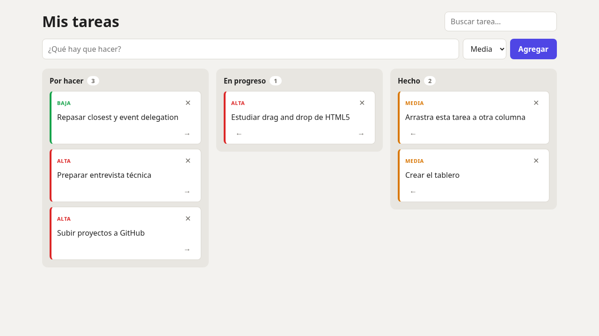

# Tablero Kanban

Tablero para organizar tareas en tres columnas: **Por hacer**, **En progreso** y **Hecho**. Lo hice en JavaScript puro para aprender a manipular el DOM y la API de drag and drop de HTML5 sin librerías.



## Funcionalidades

- Crear tareas con prioridad (alta, media, baja)
- Arrastrar y soltar tareas entre columnas
- Flechas ← → para mover tareas (en celular el drag and drop de HTML5 no funciona, así que las agregué como alternativa)
- Doble clic sobre una tarea para editarla (Enter guarda, Escape cancela)
- Borrar tareas con confirmación
- Buscador que filtra en todas las columnas
- Contador de tareas por columna
- Todo se guarda en `localStorage`
- Responsive y modo oscuro automático

## Tecnologías

HTML · CSS (grid y flexbox) · JavaScript (módulos ES) · `<template>` · Drag and Drop API

## Cómo correrlo

Usa módulos de JavaScript, así que hay que abrirlo desde un servidor local:

```bash
python3 -m http.server 8000
# o
npx serve .
```

## Cómo está hecho

- Todas las tareas viven en un array. Cada acción (crear, mover, editar, borrar) genera un array nuevo, lo guarda y vuelve a pintar el tablero con `render()`. Así la pantalla siempre muestra lo mismo que hay guardado.
- Las tarjetas se crean clonando un `<template>` del HTML en vez de armar strings de HTML, y el texto se pone con `textContent` para evitar inyectar HTML.
- Para los botones uso **event delegation**: un solo listener en el tablero en lugar de uno por cada botón de cada tarea.

## Mejoras pendientes

- Reordenar tareas dentro de la misma columna
- Fecha límite en las tareas
- Varios tableros
